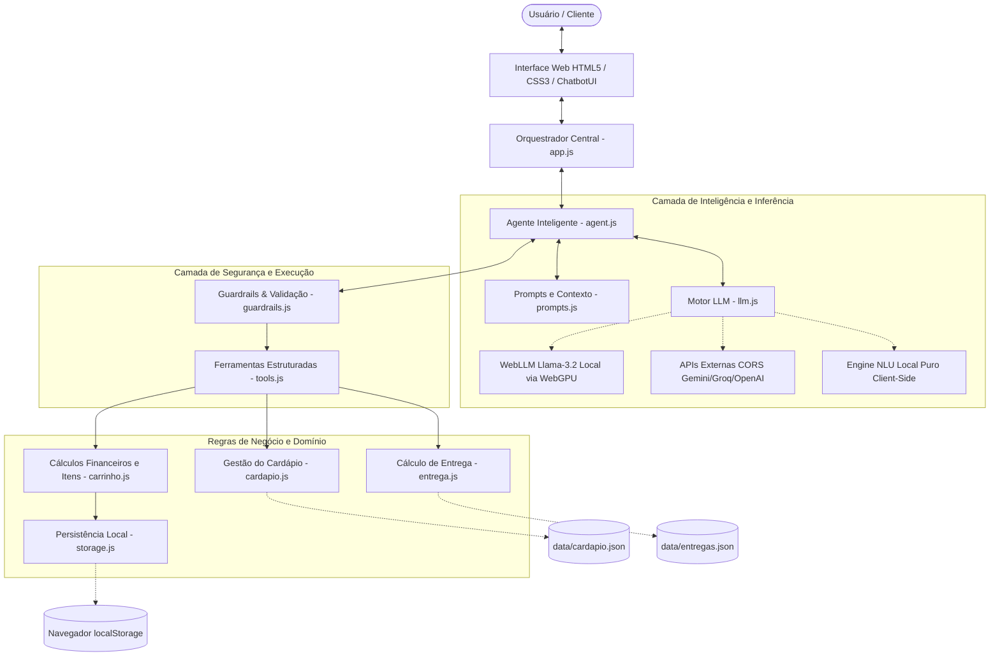
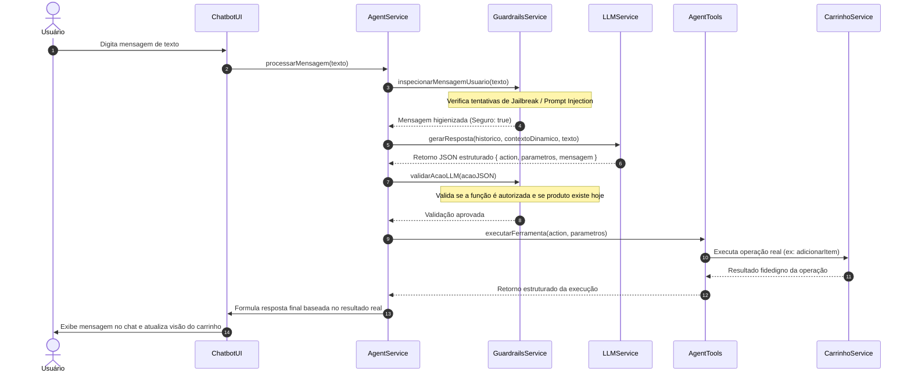

# Arquitetura do Sistema - Sabor Caseiro

Este documento descreve detalhadamente a arquitetura de software, fluxo de processamento e decisões técnicas do **Chatbot de Vendas para Restaurante de Marmitas utilizando Agente LLM**, desenvolvido integralmente no modelo *client-side*.

---

## 1. Visão Geral da Arquitetura

A aplicação opera 100% no navegador do usuário, eliminando a dependência de servidores de aplicação (Node.js, Python, Flask, etc.) ou bancos de dados tradicionais.

---

## 2. Princípios de Projeto

1. **Separação Estrita de Responsabilidades:**
   - A **LLM** interpreta a intenção em linguagem natural e propõe ações estruturadas (JSON).
   - O **JavaScript** é o único responsável pelos cálculos monetários, validação de regras de negócio, tabelas de frete e atualização de estado.
2. **Segurança por Design (Guardrails):**
   - Nenhuma ação proposta pela LLM é executada diretamente.
   - Não se utiliza `eval()` ou interpretadores de código em tempo de execução.
   - Todas as requisições passam por verificação contra *Prompt Injection*, verificação de estoque/cardápio do dia e integridade de tipos e valores.
3. **Precisão Financeira:**
   - Todos os valores são processados internamente em centavos (números inteiros), evitando desvios de arredondamento de ponto flutuante em JavaScript (`0.1 + 0.2`).
4. **Execução Client-Side Autônoma:**
   - Suporte nativo à execução de modelo LLM local (*WebLLM* via WebGPU), com opção de chaves de API informadas pelo próprio usuário em tempo de execução e engine NLU local para compatibilidade universal.

---

## 3. Fluxo de Execução do Agente

O ciclo de atendimento segue um fluxo de 10 etapas bem definidas:

---

## 4. Estrutura dos Módulos

- **`js/app.js`**: Ponto de entrada, instancia e vincula os módulos, controla eventos do DOM.
- **`js/chatbot.js`**: Gerencia a renderização de balões de mensagens, rolagem automática e digitação.
- **`js/llm.js`**: Abstração do modelo de linguagem. Conecta ao WebLLM local, APIs externas ou processador NLU.
- **`js/prompts.js`**: System prompt em português com diretrizes estritas e gerador de contexto dinâmico do restaurante.
- **`js/agent.js`**: Orquestrador do fluxo do agente (NLU -> Validação -> Execução -> Resposta).
- **`js/tools.js`**: Implementação das funções autorizadas (`consultarCardapio`, `adicionarItem`, `personalizarItem`, etc.).
- **`js/guardrails.js`**: Barreira de proteção contra jailbreaks, preços manipulados e chamadas arbitrárias.
- **`js/cardapio.js`**: Filtra itens por dia da semana e fornece informações sobre ingredientes e adicionais.
- **`js/carrinho.js`**: Fonte da verdade do pedido, cálculo de subtotais e personalizações isoladas.
- **`js/entrega.js`**: Tabela de taxas de entrega e bairros atendidos.
- **`js/storage.js`**: Persistência via `localStorage`.
